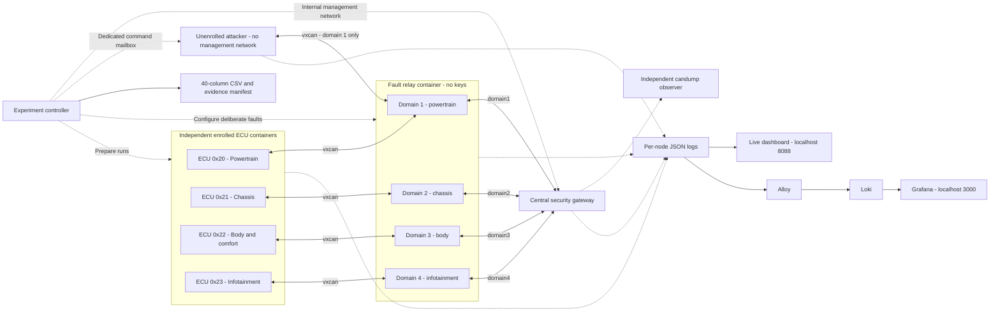
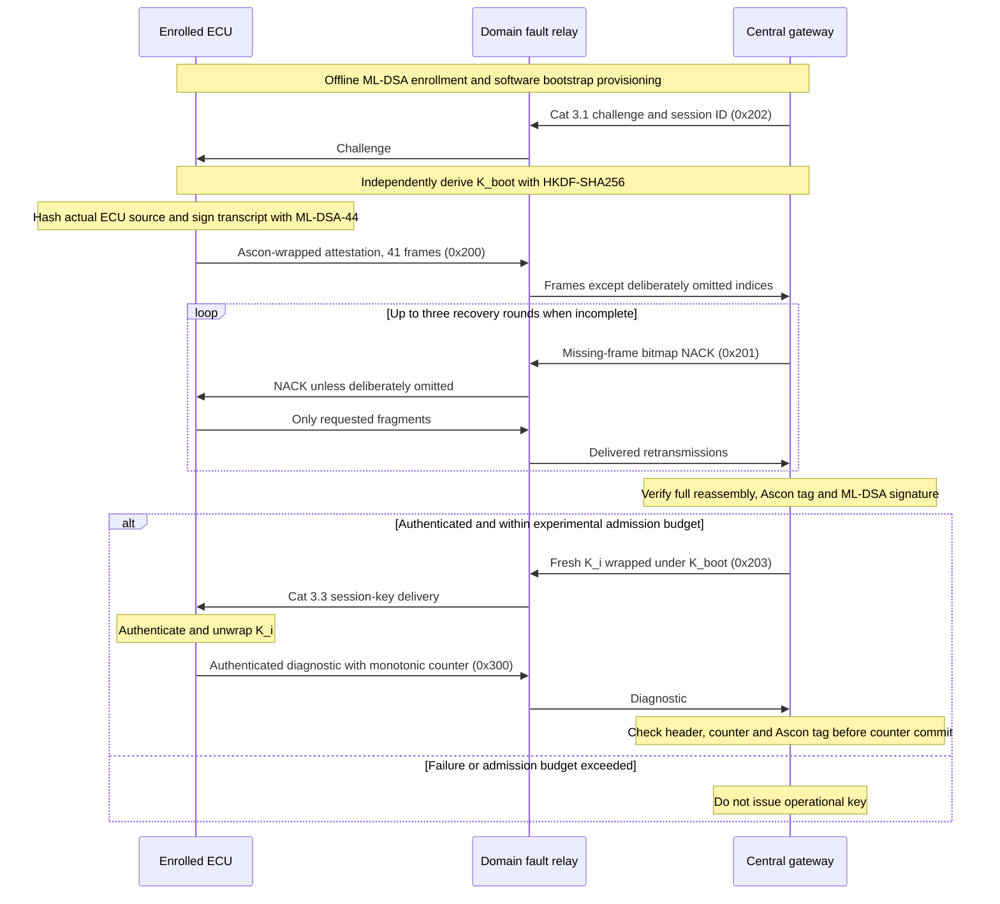

# Phase 3 Deliverable: Docker CAN-FD Empirical Benchmarking Laboratory

This laboratory is the **official Phase 3 empirical benchmarking environment** for our Post-Quantum Cryptography (PQC) and 3-Tier Intrusion Detection System (IDS) framework over CAN-FD.

---

## 1. Architectural Scope & Purpose (Phase 3 Deliverable)

- **Barebones Containerized Software Simulation:** Executes 4 independent ECU containers (Powertrain, Chassis, Body, Infotainment), an unenrolled attacker node, and a Central In-Vehicle Security Gateway (CISG) over isolated Linux SocketCAN (\xcan\) virtual interfaces.
- **Empirical vs. Mathematical Comparison:** While the **Phase 2 Simulation Suite** serves as the algorithmic and protocol proof-of-concept, **DockerLab** measures true empirical end-to-end wire transit times, host execution latency, context switches, and microarchitectural cache misses (\perf stat\).
- **Phase 3 Data Contracts Validation:** Emits empirical datasets (\perf_stat_summary.csv\, \	cpdump_latency_summary.csv\, \ault_recovery_runs.csv\) designed for direct comparison against the closed-form **worst-case response time (WCRT / Davis-Burns CAN-FD RTA)** mathematical model developed in Phase 3.

---
This lab runs **four independent ECU containers**, a central security gateway,
four isolated logical CAN domains, a controlled fault relay, an unenrolled attacker,
and an independent `candump` observer. CAN frames travel through the Linux
SocketCAN stack and `vxcan` interfaces. There is no AF_UNIX, UDP, or mock fallback.

The live dashboard displays the events written by these processes. The experiment
controller executes the scenarios and produces the 40-column fault recovery CSV.
No fixture performance values or generated vehicle measurements are used.

## Run it

From the repository root:

```bash
python3 'Phase 3/DockerLab/lab.py' up
python3 'Phase 3/DockerLab/lab.py' run
```

Open **http://localhost:8088** before running the second command to watch the
handshakes and faults live. Select a domain to inspect its fragment buffer,
authentication outcome, NACK rounds and event stream. After a suite finishes,
the latest result includes the actual attack decisions and validation outcome.

```bash
# Check the running nodes.
python3 'Phase 3/DockerLab/lab.py' status

# Follow the real container stdout logs.
python3 'Phase 3/DockerLab/lab.py' logs

# Recheck the latest saved CSV and byte-level evidence.
python3 'Phase 3/DockerLab/lab.py' validate

# Add Grafana, Alloy and Loki; Grafana is at http://localhost:3000.
python3 'Phase 3/DockerLab/lab.py' observe

# Stop only this project's containers/networks. Evidence and enrollment survive.
python3 'Phase 3/DockerLab/lab.py' down
```

The host needs Linux Docker Engine, Docker Compose, Python 3 for the launcher,
and kernel support for `CAN`, `CAN_RAW`, and `VXCAN`. Host Python does not need
cryptography packages. Dependencies are installed in the image. The launcher
creates the topology using a short-lived namespace helper, so ordinary startup
does not require host `sudo`. Docker access must already be authorized.

`up` refuses to rebuild a running/existing lab; run `down` first. It builds the
image, enrolls ECUs if this is the first launch, starts nodes, creates interfaces,
and waits for readiness. An unavailable kernel interface fails startup explicitly.
Docker Desktop/VM users must provide these modules in the Docker Linux kernel;
changing the container's distribution does not change that kernel.

## Architecture

Each domain has a distinct pair of ECU/relay and relay/gateway `vxcan` links.
The relay broadcasts only within that domain. These are four logical segments
inside one relay process, not one flat bus. The gateway terminates authentication
independently for each domain; no cross-domain forwarding policy is enabled.



Management HTTP is internal to the trusted services. It is not CAN traffic.
Only the dashboard ports are published, bound to localhost. The attacker has
`network_mode: none` and receives a CAN interface after startup. It cannot access
the management IP network, enrollment files, Docker socket, or other domains.

## PQC handshake, using the Phase 1 implementation



The code imports `crypto_engine.py` and `canfd_schema.py` from Phase 1 for:

- ML-DSA-44 key generation, transcript signing and verification.
- HKDF-SHA256 bootstrap-key derivation.
- Ascon-AEAD128 authenticated encryption/decryption.
- Category 3.1 challenge, Category 2 wrapping/reassembly, Category 3.3 key delivery.

Every ECU receives its **own** ML-DSA private key and random software provisioning
secret. The gateway stores public keys, hashed provisioning material and the
expected source measurement. Other ECUs and the attacker do not receive that key.
Private data lives only in ignored `state/credentials/` and is not printed in logs.
The random software secret replaces the earlier deterministic PUF emulator for
this experiment; it is not a claim of real SRAM-PUF measurements.

The attested measurement is SHA-256 of `ecu.py`, not a claimed vehicle firmware
measurement. Enrollment persists across restarts. If `ecu.py` changes after
enrollment, verification should reject the new measurement until an explicit
laboratory re-enrollment/firmware authorization is performed. Do not silently
rewrite the gateway's expected measurement to make such a failure disappear.

## Wire formats and boundaries

| CAN ID | Message | CAN-FD payload bytes | Encoded DLC |
|---|---|---:|---:|
| `0x202` | Phase 1 Category 3.1 challenge | 64 | 15 |
| `0x200` | Phase 1 Category 2 attestation fragment | 64 | 15 |
| `0x201` | Phase 2 bitmap NACK | 16 | 10 |
| `0x203` | Phase 1 Category 3.3 wrapped key | 64 | 15 |
| `0x300` | Lab authenticated diagnostic | 64 | 15 |

The protected attestation object is 2,436 bytes: 2,420 signature bytes plus a
16-byte Ascon tag. It uses 41 fragments with the existing four-byte header and
60-byte payload. Index 40 contains 36 active bytes and 24 padding bytes.

The NACK is the explicit Phase 2 `>BBBBIQ` format: type `0x13`, ECU ID,
retry round, reserved zero, full 32-bit session ID, 64-bit bitmap. Bit `i`
requests fragment `i`; bits 41–63 must be zero. NACK headers/session/rounds are
validated, but this lab NACK is not itself AEAD-authenticated. The three-round
limit bounds retransmission; it is not proof that forged NACK attacks are solved.

The runtime demonstration deliberately uses a **private diagnostic type `0x1f`**,
not the existing vehicle telemetry type `0x11`. Its authenticated header is
`>BBBBI`; its 40-byte plaintext is the actual source hash plus an actual
eight-byte monotonic clock reading. It demonstrates session-key use and replay
protection without disguising generated numbers as speed/RPM/wheel measurements.
The nonce is the 32-bit counter followed by twelve zero bytes under a fresh
per-session key. The gateway updates the counter only after valid authentication.

The legacy C++ gateway's two-byte fragment index and variable-length index-list
NACK are incompatible with these Python frames. This lab uses the Python
protocol consistently; it does not launch that incompatible C++ gateway.
Reserved CRC fields in the Phase 1 Category 3.3 payload remain as defined by that
implementation. They are not substituted for a CAN controller's physical CRC.

## Executed scenarios

By default, `run` performs **30 actual handshakes** and four runtime attacks:

- All five canonical scenarios on **each of the four domains**: clean; index 12;
  index 38; `14;15;16`; `20;21;22;23;24;25;26;27`.
- Persistent loss, NACK omission, ciphertext corruption, and invalid fragment
  header on domain 1.
- Five independently seeded Bernoulli loss runs on domain 1. Both initial and
  retransmitted data frames are subject to the configured probability.
- A fresh successful domain-1 handshake before runtime attacks.
- Captured diagnostic replay, forged tag, spoofed domain header, and a bounded
  300-frame injection flood. Attack success criteria are actual gateway rejection
  events, not hard-coded labels. Other domains are checked for unexpected receipt.

Use `--monte-carlo N` to change the number of random-loss runs:

```bash
python3 'Phase 3/DockerLab/lab.py' run --monte-carlo 20
```

The default per-frame application pacing is 1 ms; recovery receive timeout is
50 ms; ECU control wait is 500 ms. These are explicit experiment settings, not
CAN bitrate emulation. The gateway initially allows three seconds for actual
Python signing before its first recovery request. The experimental admission
budget is 500,000 µs from first gateway fragment receipt. It is not a HARA-derived
FTTI. CSV latency begins at the first ECU transmit log and ends at gateway
authentication/failure, so its measurement boundary is recorded separately.

An in-path relay is essential: a passive attacker on a broadcast bus cannot
remove a frame already delivered to another listener. The relay records reception,
omission or alteration, and forwarding separately. No bypass link exists.

## Logs, validation and handoff

`state/` is intentionally ignored by Git because it contains generated credentials
and potentially large evidence files. Each experiment creates a new UUID directory:

```text
state/
  credentials/                  # Per-ECU secrets and gateway enrollment; do not share
  logs/<node>/events.jsonl       # Live records, also printed to container stdout
  captures/candump.log           # Independent SocketCAN capture since lab start
  exports/latest.json           # Most recent experiment location and outcome
  exports/<suite UUID>/
    fault_recovery_runs.csv     # Exactly 40 Phase 3 columns, in order
    events.jsonl                # Snapshot of that experiment's node events
    candump_since_lab_start.log # Capture snapshot; may include preceding suites
    measurement_profile.json   # Explicit virtual-SocketCAN measurement profile
    manifest.json              # Endpoint outcomes, checks, hashes and provenance
```

Raw receive records include integer kernel `SO_TIMESTAMPNS` epoch timestamps.
Application events include integer host monotonic and epoch nanoseconds. All
containers use the same host kernel without time namespaces; subtraction uses
the monotonic clock, not dashboard polling or float epoch timestamps. TX events
are application observations immediately after `send`, not hardware TX timestamps.

The exporter preserves the exact 40-column header, semicolon-separated drop
indices, padded hex NACK bitmaps, and per-round requested/recovered counts.
It validates types, widths, finite numbers, enums, byte-level NACKs against receiver
state, actual transmit/recovery counts, artifact hashes, and success
authentication evidence. It also records source hashes for reproducibility. The export retains both ECU and gateway outcomes.
If the ECU times out without accepting any NACK while the gateway exhausts its
requests, the summary reports `ERR_TIMEOUT_NACK_WAIT` with `status_origin=ecu`.

Header mutation is recorded under `PAYLOAD_BIT_FLIP` because the strict contract
has no separate transport-header fault enum; the manifest and relay event explicitly
identify the header alteration. It is never reported as a clean fault model.
Attack-only results are in the manifest, not forced into unrelated CSV columns.

The profile remains **software-in-the-loop**, so physical bitrate, physical wire
frame/byte counts and physical goodput are blank. Host latency is measured, and
baseline differences remain signed rather than clipped. Strict Phase 3 physical
validation therefore reports those unresolved fields. Do not promote this CSV
to physical-bus evidence or copy it into the Phase 3 incoming directory as if it
passed that contract. The baseline reference run is identified in the manifest.

## Live observability

The default dashboard on port 8088 needs only the project image and reads actual
node events. It does not run attacks or have access to credentials/Docker control.
The optional `observe` command starts the official Grafana, Loki and Alloy images.
Alloy reads the JSON log files from a read-only mount; no Docker socket is mounted.
In Grafana Explore, use the provisioned Loki data source and:

```logql
{job="pqc-can-lab"} | json
```

Filter further by `run_id`, `domain`, `node`, or `event`. Anonymous access is
read-only Viewer and exposed on localhost. This is a local research configuration,
not a production deployment. The optional stack's image versions are explicit in
`compose.yaml`; the project Python base is pinned by digest.

## What this demonstrates—and what is not measured

The lab executes real cryptography, independent process scheduling, kernel CAN-FD
delivery, deliberate faults, protocol decisions, and replay/tag/rate-limit gates.
It does not reproduce physical arbitration, bus electrical faults, transceiver
behavior, physical 1/2/5 Mbps timing, hardware PUFs, or ISO 26262 certification.
Flooding measures application injection/rate-limit behavior, not physical bus
saturation. A cryptographic rejection does not imply an ML IDS detected the attack.

**Tier-2 vehicle IDS is explicitly not evaluated by this default lab.** The current
repository contains models and summary artifacts, but this execution has no supplied
complete, provenance-backed vehicle stream. The diagnostic bytes are not passed
to the vehicle model. Integrating that stage requires recorded vehicle inputs,
a versioned full sensor wire schema and the matching scaler/feature/window pipeline;
inventing missing rear-wheel values or reporting placeholder anomaly scores would
invalidate the experiment. Existing protocol/crypto Tier-1 gates run live here.

## Implementation map

| File | Responsibility |
|---|---|
| `lab.py`, `compose.yaml`, `topology.py` | Lifecycle, namespaces and least-privilege runtime configuration |
| `provision.py` | Offline software enrollment with distinct keys |
| `ecu.py`, `gateway.py` | Independent real PQC handshake/session state machines |
| `common.py` | CAN-FD serialization, socket I/O, timestamps and JSON logging |
| `relay.py` | Domain separation and deliberate in-path faults |
| `attacker.py` | Unenrolled capture/replay/forgery/spoof/flood node |
| `observer.py` | Independent `can-utils` capture |
| `controller.py` | Orchestration, observed checks and CSV/evidence export |
| `dashboard.py`, `observability/` | Live browser view and optional log stack |

The one-shot topology helper has host PID visibility and `NET_ADMIN`, `SYS_ADMIN`,
and `SYS_PTRACE` capabilities so it can enter only the seven supplied lab namespaces.
AppArmor confinement is disabled for that short-lived helper. Application containers
do not receive those setup privileges; they run as the invoking user, with read-only
root filesystems and without the Docker socket. `down` deletes the lab namespaces,
which also removes their virtual interfaces, while preserving files and volumes.

Documentation consulted: [Docker Compose](https://docs.docker.com/reference/compose-file/services/),
[SocketCAN](https://docs.kernel.org/networking/can.html),
[vxcan/container architecture](https://www.systec-electronic.com/en/blog/article/news-socketcan-docker-die-loesung),
[can-utils](https://github.com/linux-can/can-utils), and
[Alloy file collection](https://grafana.com/docs/alloy/latest/reference/components/loki/loki.source.file/).

