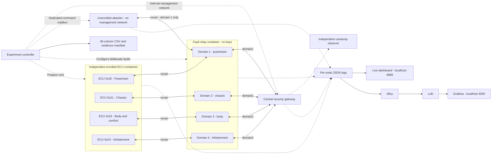
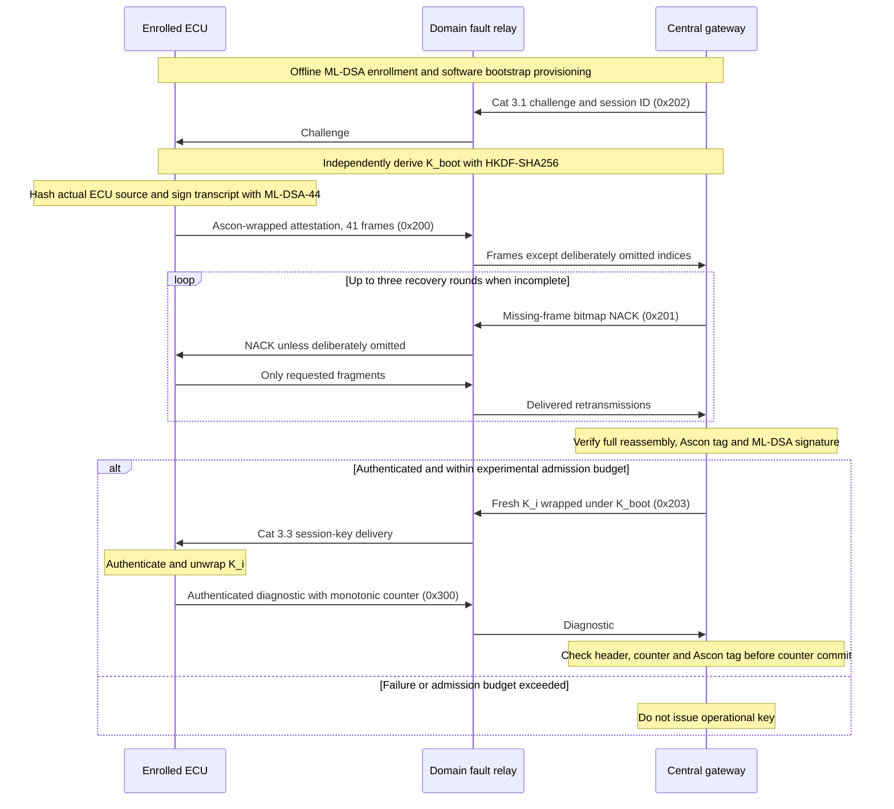

# Phase 3 Docker CAN-FD and PQC laboratory

This lab runs **four independent ECU containers**, a central security gateway,
four isolated logical CAN domains, a controlled fault relay, an unenrolled attacker,
and an independent `candump` observer. CAN frames travel through the Linux
SocketCAN stack and `vxcan` interfaces. There is no AF_UNIX, UDP, or mock fallback.

The live dashboard displays the events written by these processes. The experiment
controller executes the scenarios and produces the 40-column fault recovery CSV.
No fixture performance values or generated vehicle measurements are used.

## Run it

From the repository root:

```bash
python3 'Phase 3/DockerLab/lab.py' up
python3 'Phase 3/DockerLab/lab.py' run
```

Open **http://localhost:8088** before running the second command to watch the
handshakes and faults live. Select a domain to inspect its fragment buffer,
authentication outcome, NACK rounds and event stream. After a suite finishes,
the latest result includes the actual attack decisions and validation outcome.

```bash
# Check the running nodes.
python3 'Phase 3/DockerLab/lab.py' status

# Follow the real container stdout logs.
python3 'Phase 3/DockerLab/lab.py' logs

# Recheck the latest saved CSV and byte-level evidence.
python3 'Phase 3/DockerLab/lab.py' validate

# Add Grafana, Alloy and Loki; Grafana is at http://localhost:3000.
python3 'Phase 3/DockerLab/lab.py' observe

# Stop only this project's containers/networks. Evidence and enrollment survive.
python3 'Phase 3/DockerLab/lab.py' down
```

The host needs Linux Docker Engine, Docker Compose, Python 3 for the launcher,
and kernel support for `CAN`, `CAN_RAW`, and `VXCAN`. Host Python does not need
cryptography packages. Dependencies are installed in the image. The launcher
creates the topology using a short-lived namespace helper, so ordinary startup
does not require host `sudo`. Docker access must already be authorized.

`up` refuses to rebuild a running/existing lab; run `down` first. It builds the
image, enrolls ECUs if this is the first launch, starts nodes, creates interfaces,
and waits for readiness. An unavailable kernel interface fails startup explicitly.
Docker Desktop/VM users must provide these modules in the Docker Linux kernel;
changing the container's distribution does not change that kernel.

## Architecture

Each domain has a distinct pair of ECU/relay and relay/gateway `vxcan` links.
The relay broadcasts only within that domain. These are four logical segments
inside one relay process, with independent per-domain forwarding threads and
locks, not one flat bus. The gateway terminates authentication
independently for each domain; no cross-domain forwarding policy is enabled.



Management HTTP is internal to the trusted services. It is not CAN traffic.
Only the dashboard ports are published, bound to localhost. The attacker has
`network_mode: none` and receives a CAN interface after startup. It cannot access
the management IP network, enrollment files, Docker socket, or other domains.

## PQC handshake, using the Phase 1 implementation



The code imports `crypto_engine.py` and `canfd_schema.py` from Phase 1 for:

- ML-DSA-44 key generation, transcript signing and verification.
- HKDF-SHA256 bootstrap-key derivation.
- Ascon-AEAD128 authenticated encryption/decryption.
- Category 3.1 challenge, Category 2 wrapping/reassembly, Category 3.3 key delivery.

Every ECU receives its **own** ML-DSA private key and random software provisioning
secret. The gateway stores public keys, hashed provisioning material and the
expected source measurement. Other ECUs and the attacker do not receive that key.
Private data lives only in ignored `state/credentials/` and is not printed in logs.
The random software secret replaces the earlier deterministic PUF emulator for
this experiment; it is not a claim of real SRAM-PUF measurements.

The attested measurement is SHA-256 of `ecu.py`, not a claimed vehicle firmware
measurement. Enrollment persists across restarts. If `ecu.py` changes after
enrollment, verification should reject the new measurement until an explicit
laboratory re-enrollment/firmware authorization is performed. Do not silently
rewrite the gateway's expected measurement to make such a failure disappear.

## Wire formats and boundaries

| CAN ID | Message | CAN-FD payload bytes | Encoded DLC |
|---|---|---:|---:|
| `0x202` | Phase 1 Category 3.1 challenge | 64 | 15 |
| `0x200` | Phase 1 Category 2 attestation fragment | 64 | 15 |
| `0x201` | Phase 2 bitmap NACK | 16 | 10 |
| `0x203` | Phase 1 Category 3.3 wrapped key | 64 | 15 |
| `0x300` | Lab authenticated diagnostic | 64 | 15 |

The protected attestation object is 2,436 bytes: 2,420 signature bytes plus a
16-byte Ascon tag. It uses 41 fragments with the existing four-byte header and
60-byte payload. Index 40 contains 36 active bytes and 24 padding bytes.

The NACK is the explicit Phase 2 `>BBBBIQ` format: type `0x13`, ECU ID,
retry round, reserved zero, full 32-bit session ID, 64-bit bitmap. Bit `i`
requests fragment `i`; bits 41–63 must be zero. NACK headers/session/rounds are
validated, but this lab NACK is not itself AEAD-authenticated. The three-round
limit bounds retransmission; it is not proof that forged NACK attacks are solved.

The runtime demonstration deliberately uses a **private diagnostic type `0x1f`**,
not the existing vehicle telemetry type `0x11`. Its authenticated header is
`>BBBBI`; its 40-byte plaintext is the actual source hash plus an actual
eight-byte monotonic clock reading. It demonstrates session-key use and replay
protection without disguising generated numbers as speed/RPM/wheel measurements.
The nonce uses Phase 1 `SessionManager.derive_runtime_nonce`: ECU ID, domain,
direction, eight zero bytes, and the 32-bit counter. Fresh per-session keys prevent
counter reset from reusing a key/nonce pair. Counter exhaustion requires rekeying. The gateway updates the counter only after valid authentication.

The legacy C++ gateway's two-byte fragment index and variable-length index-list
NACK are incompatible with these Python frames. This lab uses the Python
protocol consistently; it does not launch that incompatible C++ gateway.
Reserved CRC fields in the Phase 1 Category 3.3 payload remain as defined by that
implementation. They are not substituted for a CAN controller's physical CRC.

## Executed scenarios

By default, `run` performs **31 actual handshakes** and four runtime attacks:

- All five canonical scenarios on **each of the four domains**: clean; index 12;
  index 38; `14;15;16`; `20;21;22;23;24;25;26;27`.
- Persistent loss, NACK omission, ciphertext corruption, and invalid fragment
  header on domain 1. An additional single-header probe must recover successfully;
  malformed frames no longer abort a valid handshake immediately.
- Five independently seeded Bernoulli loss runs on domain 1. Both initial and
  retransmitted data frames are subject to the configured probability.
- A fresh successful domain-1 handshake before runtime attacks.
- Captured diagnostic replay, forged tag, spoofed domain header, and a bounded
  300-frame injection flood. Attack success criteria are actual gateway rejection
  events, not hard-coded labels. Other domains are checked for unexpected receipt.

Use `--monte-carlo N` to change the number of random-loss runs:

```bash
python3 'Phase 3/DockerLab/lab.py' run --monte-carlo 20
```

Default application pacing is 250 µs, recovery timeout 5 ms, ECU control wait
50 ms, and diagnostic response wait 50 ms. These are software experiment settings,
not physical CAN bit-clock emulation. The initial signing allowance remains three
seconds so the gateway does not request retransmissions before Python signing
finishes. The **50,000 µs experimental admission budget starts before challenge
transmission** and includes signing, wrapping, delivery, recovery and verification.
ISO 26262 does not prescribe a universal 50 ms FTTI; this is not a HARA-derived claim.

Normal scenarios withhold the operational key when that budget is exceeded.
Cryptographic `SUCCESS` can therefore coexist with `SAFE_FALLBACK`; inspect
`key_delivered`, `within_admission_budget`, and the ECU outcome in the manifest.
The final handshake is explicitly labelled `admission_policy=observe` to establish
a fresh session for attack demonstrations even on slow hosts. It still reports
budget violations and is not evidence of real-time admission compliance.

CSV end-to-end time starts immediately before the gateway challenge send and ends
at gateway authentication/failure. For an observed all-NACK-loss ECU timeout, it
ends at the ECU timeout instead. `crypto_preparation` independently records only
ECU parsing, derivation, signing and wrapping, before the first attestation send;
this interval is already inside end-to-end time and is never added twice.

An in-path relay is essential: a passive attacker on a broadcast bus cannot
remove a frame already delivered to another listener. The relay records reception,
omission or alteration, and forwarding separately. No bypass link exists.

## Logs, validation and handoff

`state/` is intentionally ignored by Git because it contains generated credentials
and potentially large evidence files. Each experiment creates a new UUID directory:

```text
state/
  credentials/                  # Per-ECU secrets and gateway enrollment; do not share
  logs/<node>/events.jsonl       # Live records, also printed to container stdout
  captures/candump.log           # Independent SocketCAN capture since lab start
  exports/latest.json           # Most recent experiment location and outcome
  exports/<suite UUID>/
    fault_recovery_runs.csv     # Exactly 40 Phase 3 columns, in order
    tcpdump_latency_summary.csv # 22-column kernel RX arrival evidence
    perf_probe.txt              # Actual PMU availability probe
    events.jsonl                # Snapshot of that experiment's node events
    candump_since_lab_start.log # Capture snapshot; may include preceding suites
    measurement_profile.json   # Explicit virtual-SocketCAN measurement profile
    manifest.json              # Endpoint outcomes, checks, hashes and provenance
```

Raw receive records include integer kernel `SO_TIMESTAMPNS` epoch timestamps.
Application events include integer host monotonic and epoch nanoseconds. All
containers use the same host kernel without time namespaces; subtraction uses
the monotonic clock, not dashboard polling or float epoch timestamps. TX events
are application observations immediately after `send`, not hardware TX timestamps.

The exporter preserves the exact 40-column header, semicolon-separated drop
indices, padded hex NACK bitmaps, and per-round requested/recovered counts.
It validates types, widths, finite numbers, enums, byte-level NACKs against receiver
state, actual transmit/recovery counts, artifact hashes, and success
authentication evidence. It also records source hashes for reproducibility. The export retains both ECU and gateway outcomes.
If the ECU times out without accepting any NACK while the gateway exhausts its
requests, the summary reports `ERR_TIMEOUT_NACK_WAIT` with `status_origin=ecu`.

Header mutation is recorded under `PAYLOAD_BIT_FLIP` because the strict contract
has no separate transport-header fault enum; the manifest and relay event explicitly
identify the header alteration. It is never reported as a clean fault model.
Attack-only results are in the manifest, not forced into unrelated CSV columns.

The profile remains **software-in-the-loop**. Physical bitrate, wire bytes including
controller overhead, and physical goodput stay blank. `total_frames_on_wire` is
explicitly the logical original data + retransmit + NACK count, excluding relay
copies, challenge, key delivery and diagnostics. It is not an electrical capture
count. Recovery overhead is zero for unsuccessful/no-retry runs, otherwise the
non-negative excess over the referenced clean run; raw end-to-end values remain
unaltered in CSV and endpoint evidence.

`validate` runs the separately named software profile and checks all available
field constraints, cross-field invariants, transmitted bitmap bytes, receiver
counts, endpoint timing, artifact hashes and independent ML-DSA verification.
The shared Phase 2 validator and Phase 3 schema are unchanged. The manifest retains
strict physical-contract errors; software PASS does not mean hardware-contract PASS.

`tcpdump_latency_summary.csv` follows the **current 22-column** schema, not the
outdated 18-column list in `promt.md`. It contains actual gateway attestation
arrivals, including retransmissions and malformed frames, with integer kernel
`SO_TIMESTAMPNS` timestamps, real DLC/payload lengths, CAN flags and RX-drop counts.
The source is SocketCAN `recvmsg`, explicitly recorded in the manifest. It is not
labelled as parsed tcpdump data. Physical baud/duration and expected-pacing jitter
remain unavailable. Session IDs map back to full run IDs in `manifest.json`.
Independent `candump.log` and per-domain `.pcap` captures continue across repeated
runs. The observer does not stop because an old `latest.json` exists.

`perf` and `tcpdump` are installed. Each suite saves the real `perf stat` availability
probe in `perf_probe.txt`. A denied PMU or unsupported counter is reported as
unavailable. No `perf_stat_summary.csv` with fabricated measurements is produced.
Contract 1 still needs scoped workload profiling on supported hardware. No host
`perf_event_paranoid`/`kptr_restrict` changes are made automatically.

## Live observability

The default dashboard on port 8088 needs only the project image and reads actual
node events. It does not run attacks or have access to credentials/Docker control.
The optional `observe` command starts the official Grafana, Loki and Alloy images.
Alloy reads the JSON log files from a read-only mount; no Docker socket is mounted.
In Grafana Explore, use the provisioned Loki data source and:

```logql
{job="pqc-can-lab"} | json
```

Filter further by `run_id`, `domain`, `node`, or `event`. Anonymous access is
read-only Viewer and exposed on localhost. This is a local research configuration,
not a production deployment. The optional stack's image versions are explicit in
`compose.yaml`; the project Python base is pinned by digest.

## What this demonstrates—and what is not measured

The lab executes real cryptography, independent process scheduling, kernel CAN-FD
delivery, deliberate faults, protocol decisions, and replay/tag/rate-limit gates.
It does not reproduce physical arbitration, bus electrical faults, transceiver
behavior, physical 1/2/5 Mbps timing, hardware PUFs, or ISO 26262 certification.
Flooding measures application injection/rate-limit behavior, not physical bus
saturation. A cryptographic rejection does not imply an ML IDS detected the attack.

## Optional recorded telemetry and IDS

Without recorded inputs, diagnostics remain actual source-hash/clock bytes and IDS
reports `NOT_EVALUATED_NO_VEHICLE_TELEMETRY`. No vehicle state or anomaly score is
invented. ONNX Runtime, NumPy, the model, scaler and thresholds are included.

To evaluate your own complete recording:

```bash
python3 'Phase 3/DockerLab/lab.py' run --telemetry /absolute/path/to/recording.json
```

Input JSON must contain `schema: "pqc-recorded-raw9-v1"`, `source_kind: "recorded"`,
a nonempty `source_description`, exact `feature_names` from `telemetry.py`, and
30–1000 `samples`. Each sample contains `values` (nine finite original raw signals)
and `source_can_id` (208, 852, 1760 or 1255). Required raw order is vehicle speed,
engine RPM, steering angle, brake pressure, four wheel speeds FL/FR/RL/RR, coolant.
Do not substitute SI-unit guesses for the training signal units. Input provenance
is user-declared and hashed, not independently certified as a road recording.

The private type `0x1e` carries `>9fI` (36 signal bytes and four source-ID bytes)
inside the authenticated 40-byte plaintext. It does not redefine Phase 1 Category 1.
Missing signals are rejected. Four leave-one-wheel-out median residuals and one
speed-to-mean-wheel residual produce the exact 14 features. Normalization uses
exported scaler values without clipping; windows contain 30 consecutive samples
and reset per session or invariant rejection. No zero-padding is used.

Tier 1.5 currently checks the unit-independent all-wheels-stalled invariant; it
does not claim a full physical ruleset without calibrated units. Tier 2 reports
`WARMUP` until a complete window exists, then runs the real int8 ONNX model with
one intra/inter-op thread. Scoring follows the training notebook's per-channel
standardization and subsystem aggregation using the exported threshold file,
not a hardcoded MSE threshold. Model/artifact compatibility and detection accuracy
still require validation on representative labelled recordings. Unit tests using
numerical vectors are not vehicle evaluation results.

The replay runs only on domain 1, at 20 ms application pacing. Source data is
mounted read-only into ECU 1; the attacker never receives its enrollment keys.
See [AUDIT_REMEDIATION.md](AUDIT_REMEDIATION.md) for audit decisions and limits.

## Implementation map

| File | Responsibility |
|---|---|
| `lab.py`, `compose.yaml`, `topology.py` | Lifecycle, namespaces and least-privilege runtime configuration |
| `provision.py` | Offline software enrollment with distinct keys |
| `ecu.py`, `gateway.py` | Independent real PQC handshake/session state machines |
| `common.py` | CAN-FD serialization, socket I/O, timestamps and JSON logging |
| `relay.py` | Domain separation and deliberate in-path faults |
| `attacker.py` | Unenrolled capture/replay/forgery/spoof/flood node |
| `observer.py` | Independent `can-utils` capture |
| `controller.py` | Orchestration, observed checks and CSV/evidence export |
| `dashboard.py`, `observability/` | Live browser view and optional log stack |

The one-shot topology helper has host PID visibility and `NET_ADMIN`, `SYS_ADMIN`,
and `SYS_PTRACE` capabilities so it can enter only the seven supplied lab namespaces.
AppArmor confinement is disabled for that short-lived helper. Application containers
do not receive those setup privileges; they run as the invoking user, with read-only
root filesystems and without the Docker socket. `down` deletes the lab namespaces,
which also removes their virtual interfaces, while preserving files and volumes.

Documentation consulted: [Docker Compose](https://docs.docker.com/reference/compose-file/services/),
[SocketCAN](https://docs.kernel.org/networking/can.html),
[vxcan/container architecture](https://www.systec-electronic.com/en/blog/article/news-socketcan-docker-die-loesung),
[can-utils](https://github.com/linux-can/can-utils), and
[Alloy file collection](https://grafana.com/docs/alloy/latest/reference/components/loki/loki.source.file/).


The dedicated capture observer runs as root with `NET_RAW`, `DAC_OVERRIDE`,
`SETUID` and `SETGID` for libpcap/tcpdump and output files. It shares only the
gateway network namespace, not credentials or management controls. Other
application containers retain read-only filesystems, restricted capabilities
and the default seccomp policy. The Dockerfile-specific ignore file excludes
all `state/` directories, preventing credentials from entering image layers.

Regression checks (after building):

```bash
docker run --rm --network none pqc-can-lab:local python -m unittest test_regressions
```

The saved-CSV mutation test additionally needs the actual exports mounted at
`/evidence:ro`; otherwise that one test is explicitly skipped.
