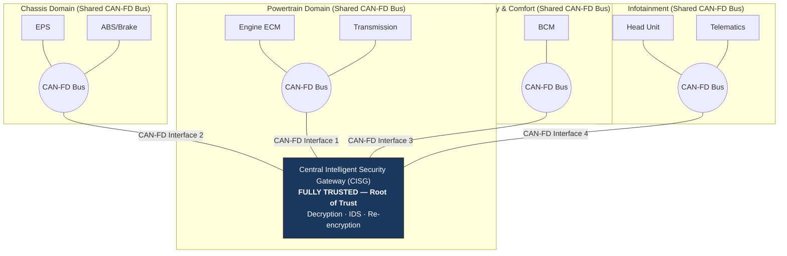
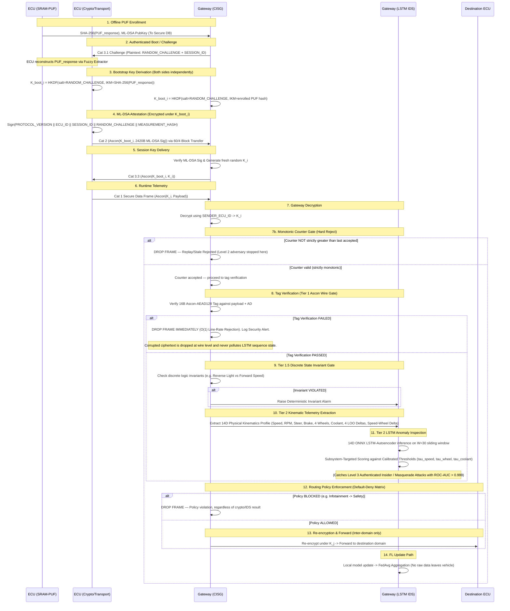

# System Architecture — Blueprint v4 Final

## PQC Security Framework for In-Vehicle CAN-FD Networks
*(Extension of Castiglione & Elia, 2025)*

---

## 0. Framing & Scope

This section describes the Phase 1–2 architecture exclusively (V2X, OTA, and physical HIL deployment are out of scope here and belong to Phases 3–4 per the workload plan).

The architecture inherits the segmented CAN-FD network model from Castiglione & Elia but fundamentally replaces three of its core baseline assumptions:
1. **Pre-shared static seed** → Replaced by **PUF-derived hardware-rooted enrollment**.
2. **Semi-trusted local gateways** → Replaced by a **single fully-trusted Central Intelligent Security Gateway (CISG)**.
3. **No attestation** → Replaced by **ML-DSA-44 post-quantum attestation** over an indexed block transfer protocol.

The trust boundaries visualised and enforced in this architecture strictly follow the authoritative Trust Boundary Analysis (Table 3), establishing the CISG as the absolute root of trust.

---

## 1. Component Inventory

The ECU performs Ascon-AEAD128 encryption *before* transmitting. The CISG is the cryptographic termination point for inter-domain traffic and a passive monitor for intra-domain traffic. **The CISG is the sole point in the architecture where decrypted plaintext from other ECUs exists.**

| Component | Owner | Trust Status | Role |
| :--- | :--- | :--- | :--- |
| **ECU (Generic Node)** | N/A | Untrusted (pre-auth) → **Authenticated, continuously monitored** (post-attestation) | Generates telemetry; encrypts/decrypts traffic using session keys. An authenticated ECU can subsequently become compromised while retaining valid credentials — hence IDS monitoring. |
| **SRAM-PUF + Fuzzy Extractor** | Kunal | Trusted (Hardware Root) | Lives inside each ECU. Reconstructs hardware-intrinsic secret for identity. |
| **Central Segmented Gateway (CISG)** | N/A | **Fully Trusted (Always)** | Sole routing hub and security authority. Decrypts inbound AEAD traffic, inspects plaintext, and re-encrypts for inter-domain forwarding. Passively monitors intra-domain traffic for IDS. |
| **Session Provisioning Module** | Kunal | Trusted | Handles HKDF derivation of the per-boot $K_{boot\_i}$ and Ascon-AEAD128-protected delivery of the fresh random $K_i$ from CISG to ECU. |
| **ML-DSA Attestation Module** | Kaustuv | Trusted | Generates and verifies post-quantum digital signatures (ML-DSA-44 / FIPS 204). |
| **Indexed Block-Transfer Engine** | Kaustuv | Trusted | Fragments the 2436B attestation object into a 41-frame burst with 64-bit NACK bitmap recovery. |
| **Secure Data Frame Handler** | Tapan | Trusted | Constructs/parses 64-byte runtime frames, extracts metadata, manages 32-bit monotonic freshness counter. |
| **LSTM-Autoencoder IDS** | Tapan | Trusted | Gateway-hosted anomaly detection. Inspects 12D feature vector post-decryption. |
| **Federated Learning Client/Agg** | Tapan | Trusted | Handles cross-vehicle model updates (Flower/FedAvg). Raw telemetry never leaves the vehicle. |

---

## 2. Domain Segmentation Model

### Logical Pure-Star Security Architecture over Physically Segmented CAN-FD Domains

The vehicle is divided into four distinct electrical CAN-FD domains (Powertrain, Chassis, Body & Comfort, Infotainment). Each domain is an electrically independent CAN-FD broadcast bus. The CISG connects to each domain through a dedicated CAN-FD controller/transceiver interface, making it the central hub.

> [!IMPORTANT]
> **Physical vs. Logical Security Topology**
>
> The proposed architecture uses a **physically segmented CAN-FD topology** rather than a literal ECU-to-Gateway physical star. Each functional domain consists of a shared CAN-FD bus containing its assigned ECUs, with the CISG connected to each domain through a dedicated CAN-FD interface.
>
> The **"Logical Pure Star"** designation refers to the cryptographic and security architecture: each ECU possesses a unique session key $K_i$, and the CISG is the central trusted authority for authentication, inter-domain routing, cryptographic verification, IDS inspection, and session-key provisioning. ECUs do not share cryptographic keys.
>
> Because CAN-FD is broadcast within a physical domain, an ECU may physically observe frames transmitted by other ECUs on the same bus. However, it **cannot decrypt** frames protected under another ECU's $K_i$. The CISG cannot physically prevent same-domain frame transmission; its active enforcement authority applies to **inter-domain forwarding** and security processing. For intra-domain traffic, the CISG operates in **Passive Monitoring Mode** — observing traffic for IDS analysis but unable to physically block the first transmitted frame.

### Gateway Operating Modes (From Physical Architecture v1.1)

| Mode | Scope | CISG Behaviour |
| :--- | :--- | :--- |
| **Passive Monitoring (Intra-domain)** | ECUs on the same CAN-FD bus | CISG observes traffic through its attached interface for IDS analysis but **cannot physically block the first transmitted frame**. ECUs communicate directly over the shared bus. |
| **Active Gatekeeper (Inter-domain)** | Traffic between different CAN-FD domains | All traffic passes through the CISG. The gateway performs routing, policy enforcement, decryption, IDS inspection, re-encryption, and may permit or deny forwarding. |

### Key Scope & Membership

* **Key Contexts (One per ECU)**: The CISG maintains exactly one active session key ($K_i$) per authenticated ECU. The gateway's metadata bookkeeping consists of a simple $N$-entry routing table mapping `SENDER_ECU_ID → K_i`.
* **Domain-Group Membership**: The assignment of an ECU to a specific domain is static and defined at manufacturing/enrollment time. The `DOMAIN_ID` is included in the CAN-FD frame header as routing and IDS metadata (to detect if an ECU physically jumps domains), but it is **not** used to select cryptographic keys.
* **Trade-off Explicitly Acknowledged**: Because keys are scoped per ECU rather than per domain, ECUs sharing a physical CAN-FD domain may observe each other's frames at the bus level but cannot decrypt frames protected under another ECU's $K_i$. For authorized inter-domain communication, the CISG decrypts and validates the source frame, applies gateway/IDS policy, and re-encrypts the message under the authorized destination ECU's $K_j$ before forwarding it to the destination domain. Same-domain transmission remains physically broadcast and is therefore monitored rather than physically intercepted by the CISG.

### Physical Domain → Policy Class Mapping

The Trust Boundary Analysis defines the Default-Deny routing policy using three **policy class names** (Safety, Comfort, Infotainment). The physical architecture uses four **domain names**. The mapping is as follows:

| Physical CAN-FD Domain | Policy Class | Rationale |
| :--- | :--- | :--- |
| Powertrain | **Safety** | Engine/Transmission ECUs are safety-critical; same protection tier as Chassis |
| Chassis | **Safety** | ABS/EPS ECUs directly affect vehicle dynamics; highest protection class |
| Body & Comfort | **Comfort** | BCM/HVAC are convenience functions; no direct safety path |
| Infotainment | **Infotainment** | Head Unit/Telematics; highest external exposure, no safety authority |

### Default-Deny Inter-Domain Routing Policy

The CISG enforces a Default-Deny policy for all inter-domain traffic. Frames that do not match an explicit Allow rule are dropped silently. All forwarding decisions are made **after** the full gateway acceptance pipeline (format check → session check → counter check → AEAD tag verification).

| Source Policy Class | Destination Policy Class | Forwarding Decision | Notes |
| :--- | :--- | :--- | :--- |
| **Safety** | **Infotainment** | ✅ Allow (read-only telemetry) | Speed, RPM etc. to Head Unit is permitted |
| **Safety** | **Comfort** | ❌ Block | No safety signal exposed to Comfort domain |
| **Comfort** | **Safety** | ❌ Block | Comfort ECUs have no authority over safety systems |
| **Infotainment** | **Comfort** | ⚠️ Allow (selected IDs only) | Restricted whitelist of CAN identifiers |
| **Infotainment** | **Safety** | 🚫 Strictly Block | Highest-priority rule; enforced unconditionally |
| Any | Any (same domain) | Intra-domain — not intercepted | CISG passively monitors; cannot block same-bus traffic |

> [!IMPORTANT]
> Automatic enforcement of this matrix requires CISG firmware to correctly map `SENDER_ECU_ID` → physical domain → policy class at runtime. Any misconfiguration of this mapping is a security-critical failure mode.

---

## 3. End-to-End Data Flow

This section details the complete lifecycle of a secure telemetry transaction, from initial hardware root-of-trust enrollment to runtime anomaly detection at the gateway.

> [!NOTE]
> **Key Scope**: The session key delivery and re-encryption steps operate on **per-ECU keys ($K_i, K_j$)**, adhering strictly to the v1.6 Logical Pure Star topology.

### Sequential Stages

1. **PUF Enrollment**: During manufacturing or secure initialization, the ECU reconstructs its device-root secret via the fuzzy extractor. The Gateway (CISG) stores only the derived verification material (the `SHA-256(PUF_response)` and the ML-DSA public key) in its secure enrollment database. It never stores the raw hardware secret.
2. **Authenticated Boot / Challenge-Response**: At startup, the Gateway issues a plaintext Category 3.1 challenge containing a fresh `SESSION_ID` and a 16-byte cryptographically secure `RANDOM_CHALLENGE`.
3. **Bootstrap Key Derivation**: Both the ECU and CISG **independently** derive the per-boot $K_{boot\_i}$ using `HKDF-Extract(salt = RANDOM_CHALLENGE, IKM = SHA-256(PUF_response))`, followed by `HKDF-Expand(PRK_boot, info = "CAPSTONE-V1/BOOTSTRAP-KEY" || TARGET_ECU_ID || SESSION_ID, L = 16 bytes)`. The raw PUF response never leaves the ECU.
4. **ML-DSA Attestation**: The ECU signs an attestation transcript containing `PROTOCOL_VERSION || ECU_ID || SESSION_ID || RANDOM_CHALLENGE || MEASUREMENT_HASH`, binding the attestation to the ECU identity, current boot session, freshness challenge, and measured software/configuration state. The 2420B signature is protected in one Ascon-AEAD128 operation using $K_{boot\_i}$ (with `RANDOM_CHALLENGE` as the nonce), producing the 2436B attestation object. It is transferred using the 60/4 indexed block-transfer protocol (a 41-frame burst with 64-bit NACK bitmap recovery).
5. **Session Key Delivery**: After verifying the ML-DSA signature against the enrolled public key, the CISG generates a **fresh, random 128-bit operational session key ($K_i$)** for that specific ECU, and delivers it wrapped in Ascon-AEAD128 under $K_{boot\_i}$ via a Category 3.3 frame.
6. **Runtime Telemetry (Secure Data Frame)**: The ECU transmits normal runtime traffic in 64-byte CAN-FD Category 1 frames. The Ascon nonce is constructed locally (never sent on the wire). A 32-bit freshness counter is sent in plaintext AD. The frame yields a 40-byte ciphertext payload and a full 16-byte Ascon-AEAD128 authentication tag.
7. **Gateway Ingress Decryption**: The CISG receives the frame, uses `SENDER_ECU_ID` to look up $K_i$, and attempts decryption.
7b. **Tier 1 Monotonic Counter Gate (Hard Reject)**: Before any IDS processing, the CISG checks the `MONOTONIC_COUNTER` in the Associated Data against the last accepted counter value for this `SENDER_ECU_ID`. The frame is **rejected outright** if the counter is not strictly greater than the last accepted value. This is a hard enforcement gate — a replayed or stale frame that nevertheless carries a valid Ascon-AEAD128 tag is still dropped here in $\mathcal{O}(1)$ time. Security posture: **replay attacks by an active adversary (Level 2) are rejected at the counter gate before ever reaching the IDS.**
8. **Tier 1 Ascon Tag Verification Gate (Line-Rate Drop)**: The CISG verifies the 16-byte authentication tag against the decrypted payload and Associated Data (AD). If tag verification fails, the frame is **dropped immediately at line-rate**. Corrupted or malicious ciphertext is discarded at the wire level and is **never** passed into the LSTM temporal window, completely eliminating hidden-state pollution.
9. **Tier 1.5 Discrete Invariant Gate**: For authenticated frames, discrete states (e.g. reverse light state vs vehicle forward speed) are cross-checked against deterministic boolean kinematic bounds, catching logical masquerades without neural network dilution.
10. **Tier 2 Kinematic Feature Extraction**: Telemetry is extracted into the **14D Physical Kinematics Profile** (`14D_PHYSICAL_KINEMATICS_LOO`):
    * **Direct Physical Signals**: Vehicle Speed ($f_1$), Engine RPM ($f_2$), Steering Angle ($f_3$), Brake Pressure ($f_4$), Wheel Speeds FL/FR/RL/RR ($f_5 \dots f_8$), Engine Coolant Temp ($f_9$).
    * **Derived Kinematic Invariants**: 4 Leave-One-Out (LOO) wheel differences ($f_{10} \dots f_{13}$) and vehicle speed vs 4-wheel mean delta ($f_{14}$).
    * **Zero-Floor Anchoring**: Standstill channels are anchored to $\text{min}=0.0$ to eliminate non-physical distortions at vehicle standstill.
11. **Tier 2 LSTM-AE Kinematic Inspection**: The 14D feature vector is pushed to a 30-timestep sliding window buffer and evaluated by the gateway-hosted ONNX LSTM Autoencoder ($24,332$ parameters). When specific CAN IDs arrive, the reconstruction error of the target subsystem channels is evaluated against calibrated, frozen thresholds ($\tau_{\text{speed}}, \tau_{\text{wheel}}, \tau_{\text{coolant}}$), detecting Level 3 Authenticated Insider Masquerade attacks with **$\text{ROC-AUC} > 0.999$**.
12. **Routing Policy Enforcement**: Before forwarding, the CISG maps the source ECU's physical domain to its policy class and applies the Default-Deny routing matrix (Section 2). Frames that violate the policy (e.g. Infotainment → Safety) are dropped regardless of cryptographic validity or IDS score.
13. **Re-encryption & Forward (Inter-domain)**: For frames that pass all prior gates, the CISG re-encrypts the 40-byte payload with a fresh nonce under the destination ECU's session key ($K_j$) and injects the new frame onto the destination domain's CAN-FD bus. For intra-domain traffic, the CISG passively monitors and logs but does not re-encrypt or re-transmit.
14. **FL Update Path**: The local LSTM model trains on the gateway. Local model weights (not raw telemetry) are aggregated via Federated Learning (Flower/FedAvg) across simulated vehicles. Raw telemetry data never leaves the vehicle.

---

## 4. Trust Boundary Overlay

### The Gateway as a Decryption Point (Not Just Routing)
It is critical to explicitly state that the CISG is a **decryption point**, not merely a blind routing node. At runtime, the Gateway holds plaintext telemetry signals and per-ECU session keys ($K_i$) in its memory. This is a significantly stronger trust assumption than a blind relay. It is precisely why the Gateway is treated as the **sole fully-trusted node** rather than one of several semi-trusted local gateways. A full compromise of the CISG compromises the confidentiality of the entire vehicle network.

### Baseline vs. Novel Trust Model (Table 3)

| Component / Layer | Castiglione & Elia (2025) Baseline | Proposed Phase 1-2 Architecture |
| :--- | :--- | :--- |
| **Physical Topology** | Segmented CAN with multiple local gateways | Segmented CAN-FD with single central CISG |
| **Identity Root** | Pre-shared static seed (susceptible to physical extraction) | SRAM-PUF hardware-intrinsic secret |
| **Gateway Trust** | Multiple semi-trusted local gateways | Single **fully-trusted** Central Intelligent Security Gateway (CISG) |
| **Attestation** | None | ML-DSA-44 post-quantum attestation over indexed block transfer |
| **Intra-Domain Enforcement** | N/A | Passive monitoring only (CISG cannot block same-bus traffic) |
| **Inter-Domain Enforcement** | Gateway routing | Active decryption, IDS inspection, re-encryption, policy enforcement |
| **Intrusion Detection** | Decentralised | Centralised Gateway-hosted ONNX LSTM Autoencoder |
| **ECU Trust After Auth** | Implicitly trusted | **Authenticated but continuously monitored** |

### Out of Scope Explicit Annotations
To ensure this architecture does not imply protections it does not provide, the following are explicitly **out of scope** for Phases 1–2:
* **Automatic Gateway Isolation**: The IDS detects anomalies but does not physically partition or isolate ECUs in this phase.
* **Intra-Domain Physical Interception**: The CISG cannot prevent ECUs on the same physical CAN-FD bus from transmitting to each other. Per-ECU keys prevent decryption but not physical bus observation.
* **V2X (Vehicle-to-Everything) Security**: Outbound external communication is not covered.
* **OTA (Over-the-Air) Updates**: Firmware update security is out of scope.

---

## 5. Interface Contracts

This section defines the precise handoffs between the modular components owned by the team (Cryptography, Transport, and Data/ML).

### Attestation → Session Provisioning (Kunal)
* **Contract**: The session provisioning HKDF consumes exactly two elements from the attestation boot phase to derive $K_{boot\_i}$:
  * **IKM (Input Keying Material)**: `SHA-256(PUF_response)`
  * **Salt**: `RANDOM_CHALLENGE` (16 bytes, received from the CISG in Cat 3.1)
  * *Note*: The `SESSION_ID` and `TARGET_ECU_ID` are only used as contextual info in the `HKDF-Expand` step.

### Session Provisioning → Secure Data Frame (Tapan)
* **Contract**: The CISG generates a fresh operational session key ($K_i$) and delivers it to the ECU. In the runtime Secure Data Frame (Category 1), the cryptographic context is resolved exclusively via the **`SENDER_ECU_ID` (Byte 1)** in the Associated Data (AD). The `DOMAIN_ID` is present for IDS routing metadata only, not for key selection.

### Block-Transfer → Attestation (Kaustuv & Kunal)
* **Contract**: The ML-DSA-44 signature (2420B) is encrypted in a *single* Ascon-AEAD128 operation to produce a 2436B protected object (2420B ciphertext + 16B tag). Kaustuv's 60/4 block-transfer protocol imposes a strict 60-byte payload limit per frame. Therefore, the 2436B object is fragmented into exactly **41 frames** (40 full frames of 60B + 1 frame with 36 bytes data + 24 bytes zero-padding). Category 3.2 selective NACK frames use compact **16-byte payloads (CAN-FD DLC 10)**.

### Secure Data Frame → IDS (Tapan)
* **Production Contract (3-Tier Defense-in-Depth Pipeline)**:
  * **Tier 1 (Deterministic Wire Gate)**: Evaluates wire integrity at line rate. If the Ascon-AEAD128 tag is invalid or monotonic counter is non-monotonic, the frame is **dropped immediately** in $\mathcal{O}(1)$ time ($100\%$ Recall, $0\%$ FPR). Corrupted ciphertext is discarded and never passed to ML temporal buffers.
  * **Tier 1.5 (Discrete Invariant Gate)**: Validates discrete boolean invariants (e.g., Reverse Light status vs forward vehicle speed) deterministically.
  * **Tier 2 (14D Physical Kinematics Autoencoder)**: Plaintext telemetry is extracted into the `14D_PHYSICAL_KINEMATICS_LOO` profile:
    - 9 Physical Signals: Speed ($f_1$), RPM ($f_2$), Steering ($f_3$), Brake ($f_4$), 4 Wheel Speeds ($f_5 \dots f_8$), Coolant Temp ($f_9$).
    - 5 Derived Kinematics: 4 Leave-One-Out Wheel Discrepancies ($f_{10} \dots f_{13}$) and Speed-Wheel Delta ($f_{14}$).
    - Ingested into the Gateway ONNX LSTM-Autoencoder using Zero-Floor MinMax scaling, evaluated against calibrated subsystem thresholds ($\tau_{\text{sub}}$) to detect masquerade attacks with zero false alarm pollution.
* **Legacy Compatibility**: The schema retains the Phase 1 `12D_LEGACY` profile (`ACTIVE_IDS_PROFILE = "12D_LEGACY"`) ensuring all Phase 1 baseline unit tests continue to pass with $100\%$ backward compatibility.

---

## 6. Residual Threats

While the combination of ML-DSA attestation and Ascon-AEAD128 encryption severely hardens the vehicle network, this architecture does not claim to definitively "solve" all threats outlined in the base paper. Specifically, **replay attacks (within the monotonic counter window)**, **Denial of Service (DoS/flooding)**, and **Black/Gray-Hole routing attacks** remain residual risks. Network segmentation and encryption reduce the exposure surface, but the LSTM IDS and Federated Learning layer serve as the actual mitigation attempt for these threats. Even then, the IDS is currently scoped strictly to **detection, not prevention**, acknowledging the limitations of Phase 1–2 development.

> [!NOTE]
> **Black-Hole / Gray-Hole Note**: These are not active threats during Phases 1–2 because the architecture contains a single trusted Central Gateway and no intermediate forwarding routers. They become relevant only if intermediate routers are introduced or the Gateway trust assumption is relaxed.

---

## Changelog

| Version | Changes |
| :--- | :--- |
| v1 | Initial draft (Sections 0–2) |
| v2 | Added Sections 3–6, generated Word document |
| v3 | Major corrections: (1) Logical Pure-Star over Segmented Domains; (2) Reordered K_boot derivation before attestation; (3) Authenticated, continuously monitored ECU status; (4) Added 14-stage lifecycle pipeline with Step 7b Counter Gate & Step 12 Routing Policy Enforcement; (5) Aligned 12D vector telemetry signals with `canfd_schema.py`. |
| v4 | Harmonized 3-Tier Defense-in-Depth Architecture: (1) Formalized Tier 1 Ascon-128 line-rate drop & Monotonic Gate to eliminate LSTM state pollution; (2) Integrated Tier 1.5 Discrete Invariant Gate; (3) Codified Tier 2 14D Physical Kinematics Profile (`14D_PHYSICAL_KINEMATICS_LOO`) with Leave-One-Out (LOO) wheel kinematics and zero-floor standstill scaling, achieving 0.9999 ROC-AUC on ROAD benchmarks while maintaining 100% backward compatibility with Phase 1 12D legacy profiles. |

